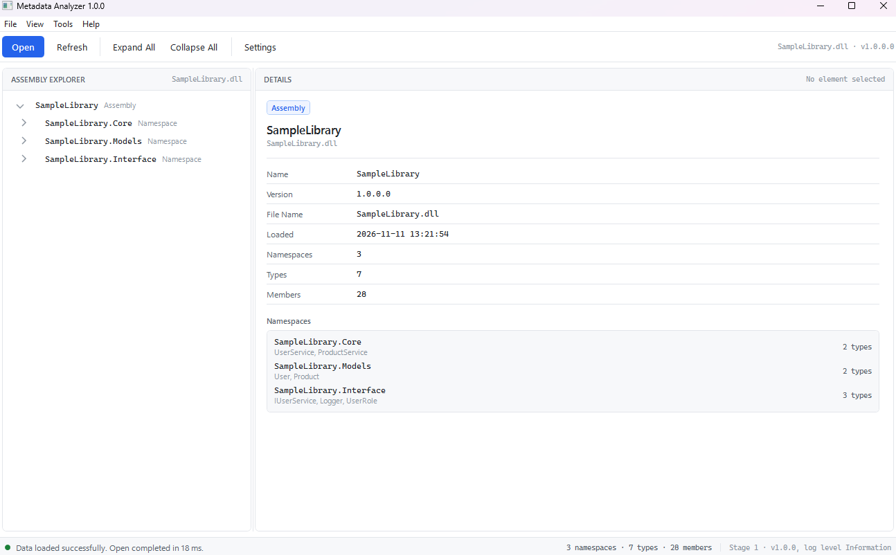

# Metadata Analyzer — Etap 1

Aplikacja do przeglądania metadanych bibliotek .NET: drzewo Assembly → Namespace → Class →
Field / Property / Constructor / Method → Parameter, panel szczegółów, log do pliku,
dwa niezależne interfejsy (**WPF** i **CLI**) na tej samej warstwie Core.

- **.NET 10**, C#, WPF/XAML, wzorzec MVVM (`CommunityToolkit.Mvvm`)
- `Core` zależy tylko od abstrakcji — nie zna WPF, CLI ani implementacji logowania
- Testy: xUnit + Moq — **60 testów, wszystkie pozytywne** (`dotnet test`)
- Build: **0 błędów, 0 ostrzeżeń** (`TreatWarningsAsErrors` + analizatory .NET, bez `#pragma`)

Pełna dokumentacja techniczna: **[DOKUMENTACJA.md](DOKUMENTACJA.md)**
(wersja PDF: `docs/MetadataAnalyzer-Etap1-Dokumentacja.pdf`).

## Struktura rozwiązania

```
MetadataAnalyzer/
├── MetadataAnalyzer.slnx              # solution (.NET 10, format slnx)
├── Directory.Build.props              # TargetFramework net10.0, Nullable, TreatWarningsAsErrors, analizatory
├── README.md / DOKUMENTACJA.md
├── docs/
│   ├── MetadataAnalyzer-Etap1-Dokumentacja.pdf
│   ├── wpf-preview.png
│   ├── ui/                            # zrzuty ekranów aplikacji
│   └── cli-smoke.txt                  # zapis sesji CLI (smoke test)
│
├── MetadataAnalyzer.Core/             # modele record, interfejsy, logika (bez UI)
│   ├── Models/                        # AssemblyModel, NamespaceModel, ClassModel, MethodModel,
│   │                                  # PropertyModel, FieldModel, ConstructorModel, ParameterModel
│   ├── Interfaces/                    # IMetadataProvider, IMetadataService, IMetadataFormatter,
│   │                                  # IAppLogger, ISystemClock
│   └── Services/                      # MockMetadataProvider, MetadataService, MetadataFormatter,
│                                      # MetadataProviderResolver, SystemClock, LogEvents, DI
│
├── MetadataAnalyzer.Infrastructure/   # implementacje: logowanie, ustawienia, kompozycja DI
│   ├── AppConfiguration.cs            # AddMetadataAnalyzer(): Core + Infrastructure + WPF/CLI, InMemoryLogSink
│   ├── Configuration/                 # AppSettings (record), ApplicationOptions, SettingsService
│   └── Logging/                       # FileLogger, LoggingOptions, InMemoryLogSink (+ SettingsAwareLogger)
│
├── MetadataAnalyzer.WPF/              # Views, ViewModels, Converters, Resources (ciemny motyw)
│   ├── Views/                         # MainWindow, SettingsWindow, AboutWindow, LogViewerWindow
│   ├── ViewModels/                    # MainViewModel, TreeNodeViewModel, DetailsViewModel,
│   │                                  # AssemblyViewModel, SettingsViewModel, AboutViewModel, LogViewerViewModel
│   ├── Converters/                    # BoolToVisibility, CountToVisibility, NullToVisibility,
│   │                                  # LogLevelToBrush, NodeTypeToIcon
│   ├── Resources/Styles/              # Colors.xaml, Controls.xaml, TreeView.xaml
│   └── App.Shell.cs                   # otwieranie okien (single-instance, izolacja błędów)
│
├── MetadataAnalyzer.CLI/              # Program, MetadataConsoleApp (menu 1–4/0), ConsolePresentation
└── MetadataAnalyzer.Tests/            # 60 testów: Models, Services, Logging, ViewModels, DI
```

Graf zależności: `WPF` → `Core`; `CLI` → `Core`; `Infrastructure` → `Core`;
`Tests` → `Core` + `Infrastructure` + `WPF`. `Core` nie odwołuje się do żadnego z nich.

## Uruchomienie

```bash
dotnet build MetadataAnalyzer.slnx
dotnet run --project MetadataAnalyzer.WPF
dotnet run --project MetadataAnalyzer.CLI
dotnet test MetadataAnalyzer.Tests
```

Wymagany .NET SDK 10.0.x.

## Co zawiera etap 1

| Obszar | Realizacja |
|---|---|
| Interfejs WPF | `Views/MainWindow.xaml`: menu (File/View/Tools/Help), pasek Open/Refresh/Expand All/Collapse All/Settings, drzewo + panel Details, pasek statusu |
| Okna WPF | Settings (ścieżka logu, poziom, UseMockData, ShowDetailsPanel), About / Application Information, Log Viewer (InMemoryLogSink) |
| Odporność okien | `App.Shell.cs`: jedno wystąpienie każdego okna, zamknięte okno jest porzucane i tworzone od nowa, błąd otwarcia → log + `ReportError` + `MessageBox`, aplikacja nie pada |
| Interfejs CLI | `MetadataConsoleApp`: menu 1 (wczytaj) / 2 (struktura) / 3 (szczegóły) / 4 (szczegóły składnika) / 0 (wyjście), ostrzeżenia przy braku danych i błędnych opcjach |
| Dane | `MockMetadataProvider` → `SampleLibrary.dll` (v1.0.0): 3 przestrzenie nazw, 7 klas (m.in. `UserService`, `User`, `IUserService`, `Logger`, `UserRole`), 28 składników |
| Drzewo (WPF) | `TreeNodeViewModel` (Assembly → Namespace → Class → Field/Property/Constructor/Method → Parameter), `ExpandAll` / `CollapseAll`, wybór aktualizuje Details bez ponownej analizy |
| Drzewo / szczegóły (tekst) | `MetadataFormatter.FormatTree` (wcięcia `+--`), `FormatDetails`, `FormatMemberDetails` |
| Szczegóły (WPF) | `DetailsViewModel`: Title / Subtitle / Kind / Items (nazwa–wartość), pusty stan `DetailsViewModel.Empty` |
| Logowanie | `FileLogger` → `Logs/application.log` (`[data] POZIOM komunikat`, append, `SemaphoreSlim`, poziom z ustawień, awaria zapisu nie rzuca); `InMemoryLogSink` dla Log Viewer; wpis `SettingsAwareLogger` respektuje zmianę poziomu w trakcie pracy |
| Ustawienia | `AppSettings` (record: `LogFilePath`, `LogLevel`, `UseMockData`, `ShowDetailsPanel`), `SettingsService.Load/SaveAsync/ResolveLogPath/NormalizeLevel/FormatSize`, `appsettings.json` kopiowany do katalogu wyjściowego |
| DI | `AddMetadataAnalyzer(configuration, logToConsole)`: `IMetadataProvider` (resolver mock/reflection), `IMetadataService`, `IMetadataFormatter`, `ISystemClock`, `IAppLogger` (FileLogger/SettingsAwareLogger + sink), `AppSettings`; `ValidateOnBuild` w testach |
| Testy | 60 testów: Models 7, MockMetadataProvider 6, MetadataService 7, MetadataFormatter 11, FileLogger 8, MainViewModel 9, TreeNodeViewModel 6, DependencyInjection 6 |

## Ustawienia (`appsettings.json`)

```json
{
  "Application": { "Name": "Metadata Analyzer", "Version": "1.0.0", "UseMockData": true, "ShowDetailsPanel": true },
  "Logging": { "Enabled": true, "Provider": "File", "FilePath": "Logs/application.log", "MinimumLevel": "Information" }
}
```

Poziomy: `Debug` / `Information` / `Warning` / `Error` (normalizacja w `SettingsService.NormalizeLevel`).
Ścieżka względna jest rozwiązywana względem katalogu aplikacji (`ResolveLogPath`).

## Przykładowy log

```
[2026-11-11 13:29:26] INFO  Application started
[2026-11-11 13:29:43] INFO  Metadata analysis started
[2026-11-11 13:29:43] INFO  Sample data loaded: SampleLibrary (SampleLibrary.dll)
```
